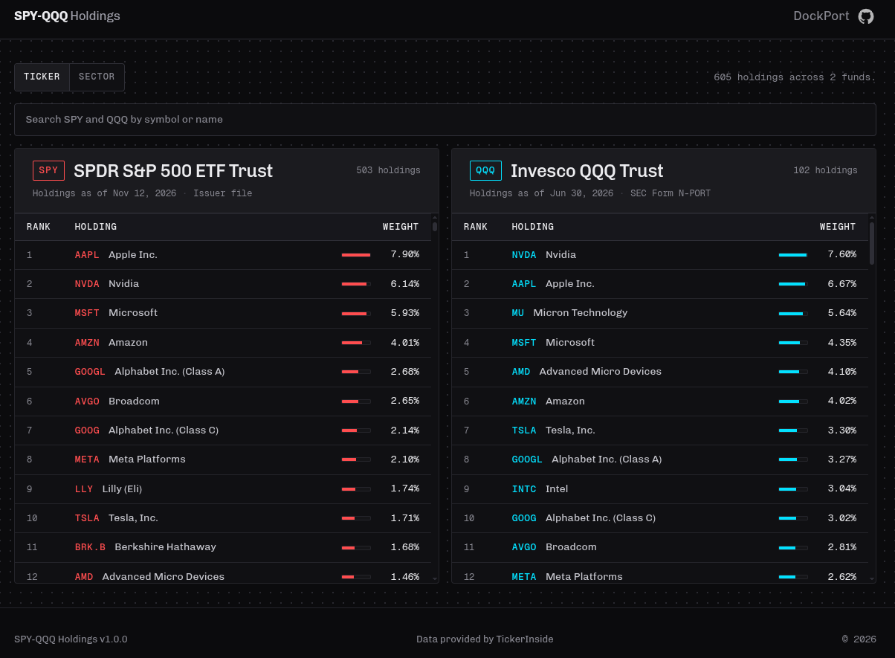

# SPY-QQQ Holdings

A static web app that shows every holding in SPY and QQQ, with its weight. It also shows the sector mix for each fund.

- Vercel deployment: https://spy-qqq-holdings.vercel.app/ 

## What it does

- Shows SPY and QQQ side by side.
- Searches both funds by ticker or company name.
- Switches between the ticker view and the sector view.
- Shows the holdings date and source for each fund.

## Data

The data comes from [TickerInside](https://tickerinside.com/) under [CC BY 4.0](https://creativecommons.org/licenses/by/4.0/).

- SPY uses the State Street issuer file. It updates each trading day.
- QQQ uses SEC Form N-PORT. It updates each quarter.

## Tech stack

- HTML, CSS, and vanilla JavaScript.
- Python 3.12 with `tickerinside==0.6.0`.
- JSON data files.
- GitHub Actions for updates.
- Vercel for static hosting.

## Preview

